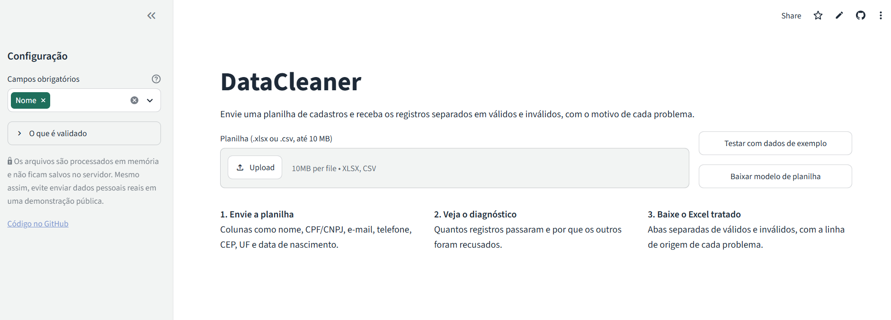
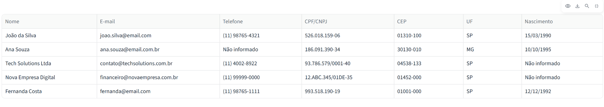
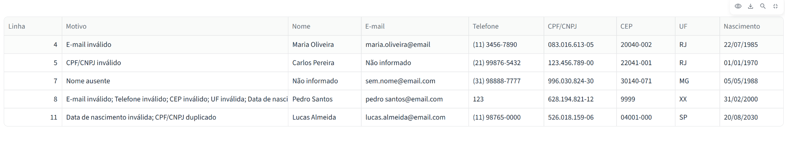
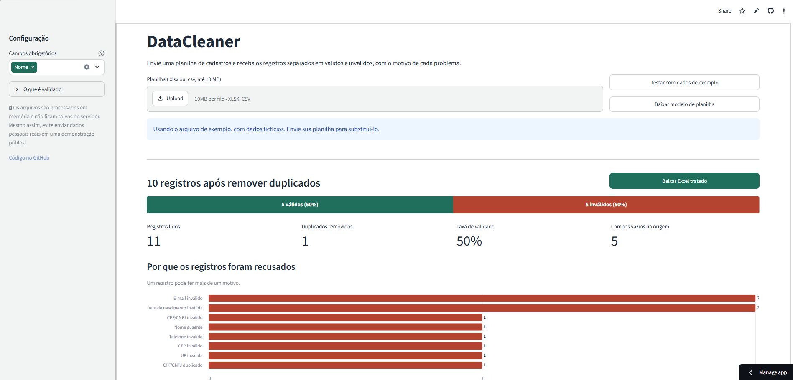

# DataCleaner Pro

Ferramenta em **Python + Pandas** para limpar, padronizar e validar cadastros de clientes (pessoas e empresas) vindos de planilhas Excel ou CSV. Separa automaticamente os registros válidos dos inválidos, indicando o motivo de cada problema e a linha de origem.

**Demo:** [datacleaner-johnatan.streamlit.app](https://datacleaner-johnatan.streamlit.app)

> Se o app estiver em modo de espera, clique em **"Yes, get this app back up!"** e aguarde cerca de 1 minuto.



Disponível de três formas: **app web** em Streamlit (upload, diagnóstico e download), **interface desktop** em Tkinter e **linha de comando**.

## Problema

Cadastros exportados de sistemas ou preenchidos à mão chegam com linhas duplicadas, nomes em caixa irregular, telefones em formatos diferentes, CPFs e CNPJs digitados errado, CEPs sem o zero inicial e campos vazios. Corrigir isso no Excel é lento e não deixa claro **o que** está errado nem **onde**.

O DataCleaner padroniza o que dá para corrigir, separa o que precisa de correção humana e gera um relatório auditável do processamento.

## Saída

O arquivo `saida/dados_tratados.xlsx` tem duas abas:

| Aba | Conteúdo |
|---|---|
| **Válidos** | Registros aprovados em todas as validações, já padronizados e prontos para uso |
| **Inválidos** | Registros com problema, com a coluna `linha_origem` (linha na planilha original) e a coluna `motivo` (todos os problemas encontrados, ex.: `CPF/CNPJ inválido; CEP inválido`) |

As abas saem com cabeçalho destacado, filtro, primeira linha congelada e largura de colunas ajustada.

Na linha de comando e na interface desktop também são gerados `saida/relatorio_processamento.xlsx` (totais e contagem por motivo) e `logs/processamento.log`. No app web, o relatório vai como terceira aba do Excel baixado.

## App web

- Upload de `.xlsx` ou `.csv` (até 10 MB), ou teste com o arquivo de exemplo em um clique
- Barra de triagem com a proporção de válidos e inválidos, indicadores e gráfico dos motivos de recusa
- Tabelas de válidos e inválidos navegáveis, e download do Excel tratado
- Campos obrigatórios escolhidos na barra lateral
- Processamento **em memória**: nada é gravado no servidor

## Telas

**Aba Válidos** do Excel tratado:



**Aba Inválidos**, com a linha de origem e todos os motivos de cada registro:



**Interface desktop:**



## Validações

| Campo | Regra | Padronização |
|---|---|---|
| Nome | Obrigatório | Espaços extras removidos, iniciais maiúsculas, preposições em minúsculas |
| E-mail | Formato válido | Minúsculas |
| Telefone | DDD existente; celular com 9 dígitos começando em 9; fixo com 8 dígitos começando em 2 a 5 | `(11) 98765-4321`, remove `+55` |
| CPF | Dígitos verificadores; rejeita sequências repetidas | `000.000.000-00` |
| CNPJ | Dígitos verificadores nos formatos **numérico e alfanumérico** (em vigor desde julho de 2026) | `00.000.000/0000-00` |
| CPF/CNPJ | Coluna única que aceita os dois; identifica o tipo pelo cálculo | Conforme o tipo |
| CEP | 8 dígitos | `00000-000` |
| UF | Uma das 27 siglas | Maiúsculas |
| Data de nascimento | Data existente, não futura, idade até 120 anos | `dd/mm/aaaa` |
| Duplicidade | Linhas idênticas são removidas; o mesmo CPF/CNPJ em registros diferentes vai para inválidos | |

Todas as colunas são opcionais, exceto as definidas em `CAMPOS_OBRIGATORIOS` (ou escolhidas na barra lateral do app web). CSVs em UTF-8 ou Latin-1, separados por vírgula ou ponto e vírgula, são lidos automaticamente. Os cabeçalhos são reconhecidos com variações: `E-mail`, `Celular`, `CPF/CNPJ`, `Data de Nascimento`, `Razão Social` etc. (lista em `config.py`).

## Antes e depois

Com o arquivo de exemplo (`exemplos/clientes_exemplo.csv`, dados fictícios):

| Antes | Resultado |
|---|---|
| `  joão DA silva ` · `526.018.159-06` · CEP `1310100` · `sp` | **Válidos:** `João da Silva` · `526.018.159-06` · `01310-100` · `SP` |
| `Nova Empresa Digital` · `12.ABC.345/01DE-35` | **Válidos:** CNPJ alfanumérico reconhecido |
| `maria oliveira` · CPF `8301661305` · `maria.oliveira@email` | **Inválidos:** CPF recuperado como `083.016.613-05`, motivo `E-mail inválido` |
| `lucas almeida` · CPF já usado por outro cliente · nascimento `20/08/2030` | **Inválidos:** `Data de nascimento inválida; CPF/CNPJ duplicado` |
| `pedro santos` · telefone `123` · CEP `9999` · UF `XX` · `31/02/2000` | **Inválidos:** cinco motivos listados |

## Arquitetura

```
 streamlit_app.py (web)    main.py (CLI)    interface.py (Tkinter)
          │                      │                  │
          │ upload em memória    └──── arquivo ─────┘
          ▼                               ▼
 DataCleaner  ◄── validacoes.py (regras)  ◄── config.py (aliases, obrigatórios, caminhos)
          │                               │
          ▼                               ▼
 download do Excel              saida/dados_tratados.xlsx  [Válidos | Inválidos]
 [Válidos | Inválidos | Relatório]   saida/relatorio_processamento.xlsx
                                 logs/processamento.log
```

O núcleo (`tratamento.py` e `validacoes.py`) é o mesmo para as três interfaces: a lógica de validação não conhece Streamlit nem Tkinter.

## Decisões técnicas

- **Inválido não é apagado nem "corrigido" à força:** o registro vai para a aba de inválidos com o valor original, o motivo e a linha de origem, para que alguém possa corrigir na fonte.
- **Todos os motivos de uma vez:** o registro acumula todos os problemas encontrados, em vez de parar no primeiro. Quem corrige resolve tudo numa passada só.
- **Leitura como texto:** todas as colunas são lidas como texto para não perder zeros à esquerda. Quando a planilha já vem com o zero perdido (CPF de 10 dígitos, CEP de 7), ele é recuperado, e o dígito verificador garante que a recuperação está correta.
- **CNPJ alfanumérico:** o cálculo usa o valor ASCII menos 48 para cada caractere, regra da Receita Federal que funciona igual para CNPJs numéricos antigos e para os novos com letras. Os testes usam os exemplos oficiais.
- **Duplicados após a padronização:** `joão silva ` e `João Silva` só são reconhecidos como iguais depois de tratados. CPF/CNPJ repetido em cadastros diferentes indica conflito e vai para revisão.
- **Regras declarativas:** cada campo é uma entrada no dicionário `REGRAS` (validar, formatar, motivo). Adicionar uma validação nova é escrever duas funções e uma linha.
- **App web sem disco:** o upload é lido de um `BytesIO` e o Excel é gerado em memória. O resultado fica em cache por conteúdo do arquivo, então trocar os campos obrigatórios ou de aba não reprocessa à toa.
- **Dados fora do Git:** `entrada/`, `saida/` e `logs/` estão no `.gitignore`.

## Tecnologias


## Como executar

```bash
git clone https://github.com/johnatantech/DataCleaner.git
cd DataCleaner
python -m venv venv
```

Ative o ambiente virtual (`.\venv\Scripts\Activate.ps1` no Windows ou `source venv/bin/activate` no Linux/macOS) e instale as dependências:

```bash
pip install -r requirements.txt
```

| Modo | Comando |
|---|---|
| App web | `streamlit run streamlit_app.py` |
| Linha de comando | `python main.py exemplos/clientes_exemplo.csv` |
| Interface desktop | `python interface.py` |
| Testes | `pip install -r requirements-dev.txt` e depois `pytest` |

Sem argumento, a linha de comando procura `entrada/clientes.xlsx`.

## Publicar no Streamlit Community Cloud

1. Acesse [share.streamlit.io](https://share.streamlit.io) e entre com a conta do GitHub
2. Clique em **Create app**, escolha o repositório `johnatantech/DataCleaner`, branch `main` e arquivo `streamlit_app.py`
3. Em **Advanced settings**, selecione Python 3.12 ou superior e clique em **Deploy**

O Streamlit instala o `requirements.txt` e aplica o tema de `.streamlit/config.toml`.

## Estrutura

```
DataCleaner/
├── streamlit_app.py         # app web: upload, diagnóstico e download
├── main.py                  # linha de comando e fluxo de processamento
├── interface.py             # interface desktop Tkinter
├── tratamento.py            # classe DataCleaner e tabela de regras
├── validacoes.py            # validação e formatação de cada campo
├── relatorios.py            # gravação das abas e do relatório
├── config.py                # aliases de colunas, obrigatórios, caminhos
├── .streamlit/config.toml   # tema e limite de upload do app web
├── exemplos/
│   └── clientes_exemplo.csv # dados fictícios para teste
├── tests/
│   ├── test_validacoes.py   # regras de cada campo
│   └── test_tratamento.py   # fluxo completo, leitura em memória e obrigatórios
├── requirements.txt
├── requirements-dev.txt
└── .gitignore
```

## Limitações conhecidas

- O dígito verificador confirma que o CPF/CNPJ é bem formado, não que existe ou está ativo na Receita Federal.
- A validação de e-mail checa o formato, não se o endereço existe.
- O CEP é validado pelo formato; não há consulta à base dos Correios.

## Próximos passos

- Consulta de CEP via API (ViaCEP) para confirmar existência e completar endereço
- Integração contínua com GitHub Actions rodando os testes a cada push

## Autor

**Johnatan Flores** · [GitHub](https://github.com/johnatantech) · [LinkedIn](https://www.linkedin.com/in/johnatan-flores-67595a221/)
